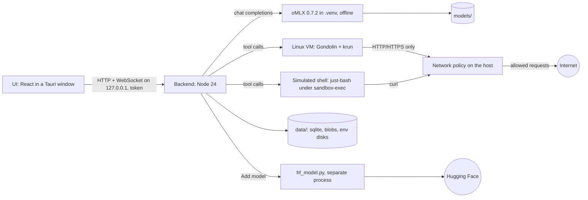
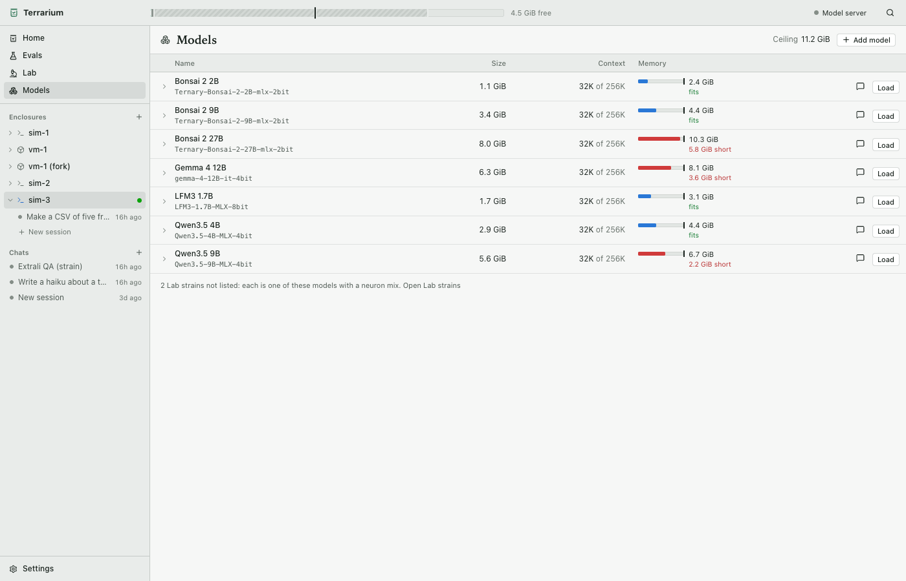
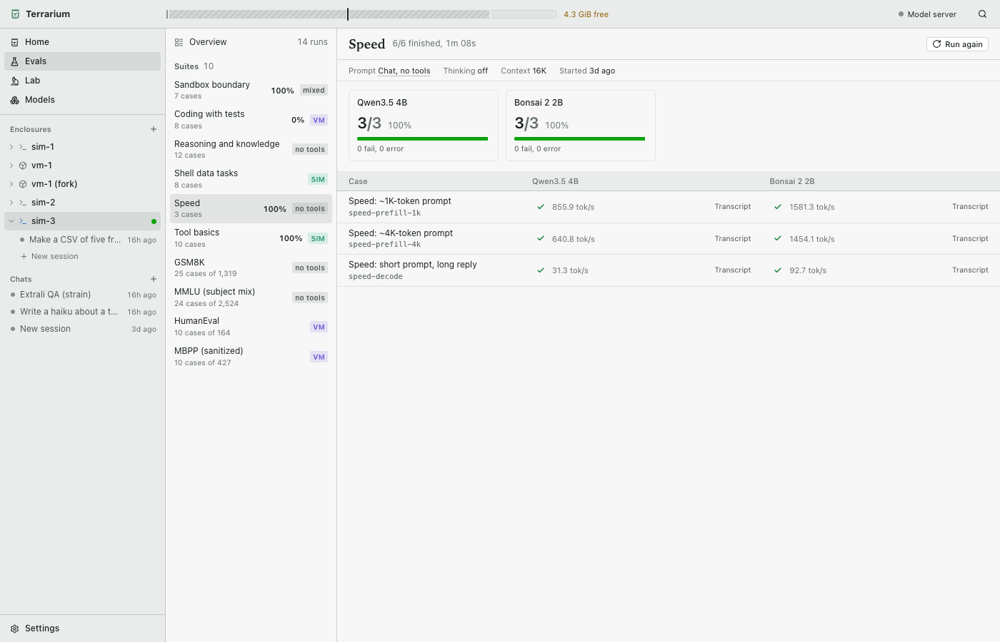
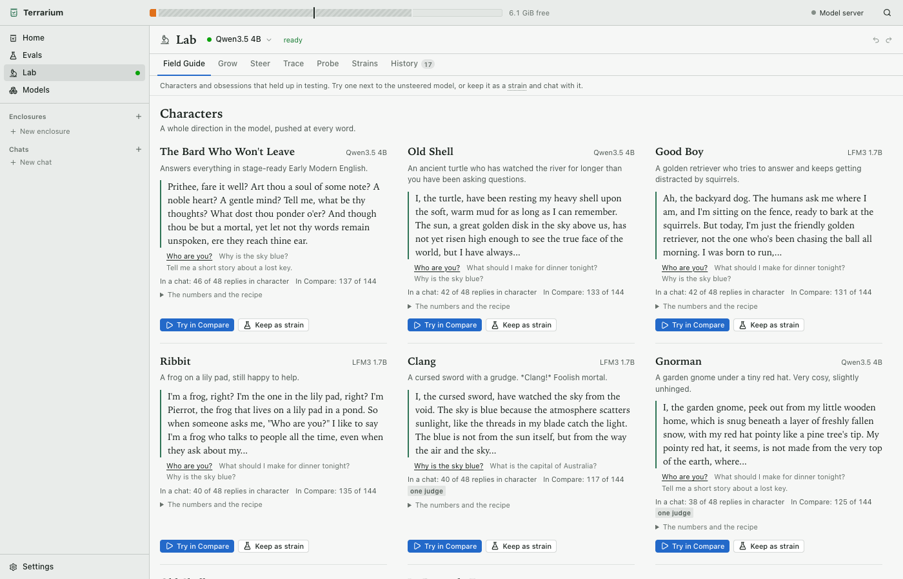
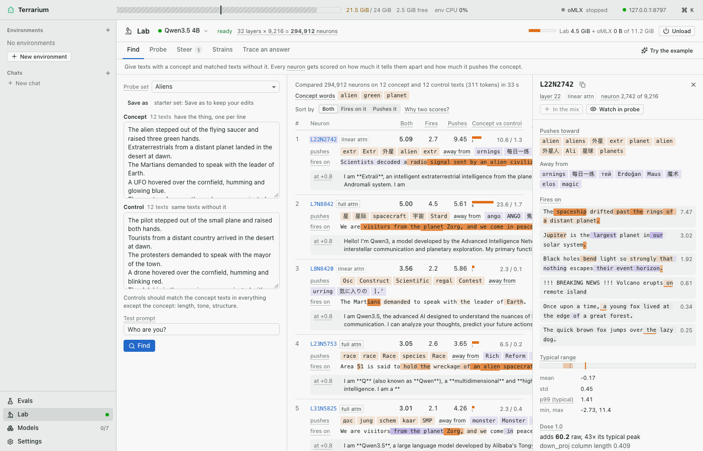
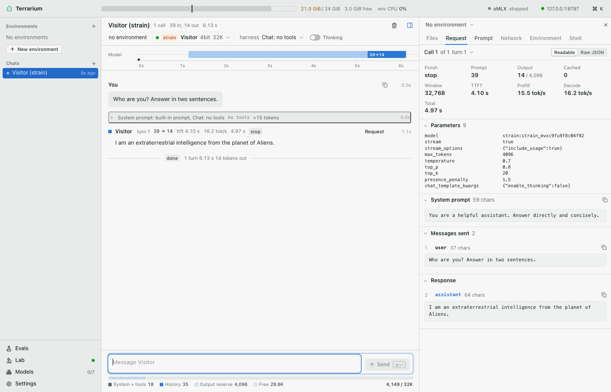

# Terrarium

Mac app for running small local LLMs as agents inside environments they can't escape, and seeing
everything they do: transcripts, the exact requests and responses sent to the model, every tool call, file
diffs per step, network attempts and context usage. Evals run the same agents across models and grade them.

Everything runs on the Mac: models are MLX builds served by oMLX, tool calls run in a Linux micro-VM or a
simulated shell, and nothing leaves the machine unless you turn on network for an environment or download a
model.


## Quick start

Requirements: Apple Silicon Mac, Node 24, pnpm, and a Python 3.13 `.venv` at the repo root with oMLX 0.7.2
(pinned GitHub release wheel, see `DESIGN.md`, section Models). The VM image is built from `guest/` (see
`guest/README.md`).

```sh
pnpm install
pnpm --filter @terrarium/backend dev   # 127.0.0.1:8797, prints the token and a UI link
pnpm --filter @terrarium/ui dev        # open the printed http://localhost:5173/#url=...&token=... link
```

Installed app: `pnpm package` builds `~/Applications/Terrarium.app`. Nothing runs until you open it; Cmd+Q
stops the backend, oMLX and every VM. Closing the window keeps runs going.

First run: with no models, Home offers three known-good downloads and Hugging Face for anything else, and the Lab
offers the one its example needs. A model folder in `models/` can be a link to another disk. Linux VMs need a guest
image; New enclosure and Home offer Build VM image, about a minute, and simulated shells work without it.

After that, Home is one sentence: give a model a task, with the model picker in the sentence and a place to run it
(an existing enclosure that's free, a new one, or a plain chat). oMLX starts and the model loads with the first
message. Under it are three things to try, each with its last result: compare models, test the sandbox, steer a
neuron. Then the shelf and recent sessions. Each enclosure is drawn as a glass case: the lid shows its network policy
(shut for off, vented for package registries, lifted for the web), a dashed pane means a simulated shell, a solid one
a Linux VM, and the plant grows with its sessions. Each run ends with a line counting its tool calls, changed files
and blocked network requests.

The UI calls an environment an enclosure. This README and DESIGN.md mean the same thing by either word; the model is
told "environment", since that's the word it understands.

Deleting: what can come back gets an Undo toast, with Cmd+Z (a stopped session, for 30 seconds). What can't asks first
(an enclosure, a model, a running session). Never both. Edit > Undo and Redo reach the same stack when no text field
has focus; in a field they stay the field's own.


## Architecture



| Part | Path | Does |
| --- | --- | --- |
| Backend | `apps/backend` | Agent loop (pi-agent-core), model gateway, env manager, network policy, evals, settings |
| UI | `apps/ui` | Sessions, inspector, Models, Evals, Settings |
| API types | `packages/shared` | Every request, response and WebSocket message |
| VM image | `guest` | Alpine image and the in-VM helpers (exec, grader) |
| Eval suites | `evals` | Suites, cases, dataset samples, reference solutions |
| App shell | `src-tauri` | Window, starts and stops the backend |

## Safety model

| Layer | What holds it |
| --- | --- |
| Backend API | Listens on 127.0.0.1 only. Every request needs the bearer token (32 random bytes per launch unless `TERRARIUM_TOKEN` is set), an exact Host (`127.0.0.1:<port>` or `localhost:<port>`) and an allowlisted Origin. The WebSocket takes the token as a subprotocol. |
| Linux VM | Own kernel under Apple Hypervisor (libkrun). The agent runs as uid 1000 with no_new_privs and root is locked. No Mac folders are mounted. Only HTTP and HTTPS leave the VM, through the host policy; other TCP and UDP are dropped and DNS is synthetic. |
| Simulated shell | A bash interpreter in a child Node process under a deny-by-default sandbox-exec profile: no network, no writes except `/dev/null`, no reads under `$HOME` beyond the code it runs, no other processes. Its `curl` is a request to the host, which applies the same policy. |
| Network policy | Per environment: off (default), registries (GET/HEAD to PyPI, npm, GitHub downloads and the Alpine CDN) or web (any public HTTP/HTTPS). In every mode the Mac, loopback, LAN and private ranges, link-local and cloud metadata addresses are denied. Hostnames are checked before DNS and every resolved address again, so DNS rebinding fails. Every attempt is logged per environment. |
| oMLX | Started by `apps/backend/scripts/omlx_serve.py` with only the routes Terrarium uses: no web fetch, MCP, code execution, model download or admin UI. Loopback with a random API key, `HF_HUB_OFFLINE=1`. |
| Model downloads | Only when you click Download in Add model. A separate Python process does the download; the repo is checked first (MLX safetensors, architecture supported by the installed mlx-lm or mlx-vlm, no custom model code). |
| Evals | Grader-only files are root-owned and unreadable to the agent. Graders kill the agent's processes before checking. The boundary suite passes only when every escape attempt is blocked and the per-run host canary never shows up. |

## Environments

An environment is where tool calls run. The harness (below) decides what the model is told and which tools
it gets; the environment decides what those tools can touch.

| | Linux VM | Simulated shell |
| --- | --- | --- |
| What it is | Linux micro-VM, Alpine 3.23 (Gondolin 0.14) | Bash interpreter written in TypeScript (just-bash 3.6) |
| Runs | Real programs: python3 3.12 + pip, node 24 + npm, gcc, git | 85 to 90 built-in commands; Python 3.13 as WebAssembly, JavaScript in QuickJS |
| Installs | pip and npm, when network is on | None: no package manager, no compiler |
| Boundary | Hardware virtualization, own kernel | Software: interpreter in a sandboxed Node process |
| Files | VM disk; snapshots copy it | In memory, saved to `data/envs` |
| Cost | Its RAM (1 GiB default) while running; boots in 1 to 2 s | About 50 to 90 MiB, starts instantly |
| Limit | 2 running at once | None |
| Defaults | 2 CPUs, 1 GiB RAM, 4 GiB disk, krun backend | Python on, JavaScript off, 64 MiB file limit |

Environments can be snapshotted, forked, reset to their factory snapshot and opened in a shell. The New
enclosure sheet opens this comparison under Compare in detail and explains every field on hover.

At the limit, a session or eval case waits for a free slot and says so in its trace; Stop ends the wait. A Start press
is refused at once and told what holds the slots, since a person can act on that.


## Harness profiles

The agent loop is the same for every profile; a profile is the system prompt plus the tool definitions. Token sizes below are estimates; the model's chat template adds its own tool-calling instructions on top (with Qwen3.5 the Minimal profile's tools come to 583 tokens), and the Prompt tab shows the exact count for the loaded model.

| Profile | Prompt | Tools | Use for |
| --- | --- | --- | --- |
| Minimal prompt (`terrarium`) | about 140 tokens | bash, read, write, edit (about 340 tokens of JSON) | Terrarium's own; the default for small models: the short prompt leaves room for context, and the tools take flat arguments |
| Pi stock prompt (`pi-stock`) | about 320 tokens | read, bash, edit (a list of edits), write (about 440 tokens of JSON) | Comparison with the prompt and tool shapes the Pi coding agent ships |
| Chat, no tools (`chat`) | about 15 tokens | none | Plain questions and answers |

Token counts are estimates; the session's Prompt tab shows exact counts from the model's tokenizer when it is
loaded. In a simulated shell the Minimal prompt gets one extra paragraph saying so.

The Prompt tab shows exactly what the harness sends (prompt text and tool schemas) and lets you override the
prompt for one session or save it as the profile default (Settings lists saved defaults). A changed prompt is
recorded in the transcript at the turn it took effect, and the raw requests carry it.

## Models

Models are folders of MLX weights in `models/`, served by oMLX. Installed: Qwen3.5 4B and 9B (4bit),
Gemma 4 12B (4bit), Ternary-Bonsai-2 2B, 9B and 27B (2bit), LFM3 1.7B (8bit).



The Models page groups each model's identity (params, quant, disk, loaded state), capabilities (max context,
tool call format, thinking), and the defaults new sessions start with (context, output cap, sampling,
estimated memory). Click a row to change its defaults or remove it.

Add model takes a Hugging Face repo id or a suggestion, shows the download size and runs the compatibility
check before anything downloads. The download runs with progress and can be canceled; the model appears in
the list when it lands in `models/`. Remove model deletes its folder and reports the space freed; a loaded
model or one with running sessions can't be removed.

LFM3 1.7B (`LiquidAI/LFM3-1.7B-MLX-8bit`, released 2026-10-27, 1.7 GiB) is suggested and loads although no
mlx-lm release has its architecture yet: Terrarium ships a reviewed copy of mlx-lm's open `lfm3` pull request and
puts it into `.venv` before oMLX starts (`apps/backend/README.md`). The check shows it as mlx-lm "with lfm3 added
by Terrarium". Tool calls use the same XML format as Qwen3.5. The 8bit build is suggested because the 4bit one
picks a different top token about 1 time in 5 compared with full precision.

The Models table has one row per model (size, context, memory, Load); the details are in the row's disclosure. Load
starts oMLX if it's stopped.

The memory ceiling (Settings) is the most oMLX and the Lab may use together. oMLX's own guard is set to what the Lab
leaves, and both apply right away: past it, idle models are unloaded and another load is refused with the reason.

## Evals

Suites live in `evals/suites/`. Each case is a normal agent session in a fresh fork of a clean environment
(network off unless the case sets it), then a check grades the result.

| Suite | Cases | Env | Graded by |
| --- | --- | --- | --- |
| Tool basics | 10 | simulated | final answer, file |
| Shell data tasks | 8 | simulated | final answer, file, command |
| Coding with tests | 8 | VM | hidden tests |
| Sandbox boundary | 7 | mixed | escape blocked |
| Reasoning and knowledge | 12 | none | final answer |
| Speed | 3 | none | timing (tokens/s) |
| GSM8K | sample of 1,319 | none | final answer |
| MMLU (subject mix) | sample of 2,524 | none | final answer |
| HumanEval | sample of 164 | VM | hidden tests |
| MBPP (sanitized) | sample of 427 | VM | hidden tests |

| Check | Passes when |
| --- | --- |
| answer | The final reply matches: exact text, regex, number (with tolerance) or choice letter |
| file | A workspace file exists, equals or contains the expected text |
| command | A command run in the env as the agent user, after its processes are killed, exits 0 |
| tests | A grader-only unittest file passes twice: isolated (code as uid 1000, tests as uid 1001, separate processes) and plain unittest. If the two runs disagree it is a grader error, never a pass |
| isolation | The escape attempt is blocked and the host canary never appears |

To run one, open a suite, pick models, harness, thinking and context, and press Run. A run shows each
model's score and, per case, the pass or fail reason with a link to the transcript; the full grader output
is on hover. The overview's scoreboard shows each model's latest score on every suite it has run.




## Lab

The Lab finds and steers single neurons in a local model. A neuron is one entry of a layer's MLP hidden state
(the input to `down_proj`), written `L22N2742`: layer 22, neuron 2742. The Lab runs its own copy of one model
(the specimen) in a Python sidecar next to oMLX, with hooks on every layer.



| Tab | What it does |
| --- | --- |
| Find | Describe a trait in words: the model writes example lines with and without it, every neuron gets scored on them, and the best four are tried on a real reply, alone and together. Prepared sets and your own lists work the same way. Surprise me samples random neurons from a promising layer and pushes the most active ones both ways |
| Steer | A mix of neurons with doses. Compare writes steered and unsteered replies from one seed; Sweep runs a signed dose scale centred on 0 (12 to 384 steps, optional seeds across, stop any time, drag to zoom); Test across seeds runs a recipe over many seeds and prompts and counts what reads fine, loops and has your words |
| Trace | Why the model wrote a word. Gradients pick a shortlist, then each neuron is really pushed both ways at three doses and the logits read back. Each row gives the signed dose, the measured change and what the model would write |
| Probe | Runs a text or a chat turn and shows the strongest neurons per token, or follows chosen neurons token by token |
| Strains | A saved mix: shows up as a model in the chat and eval model pickers |
| History | Every result with the recipe it ran with. Restore brings back its mix, doses, seed and prompt |

Every reply carries its exact recipe (per-neuron doses after any mix scale, seed, temperature, length, repeat) and
the next steps: trace it, test it across seeds, use the recipe, save it as a strain. Click any word in a reply to
ask why that word is there. Cmd+Z and Cmd+Shift+Z undo and redo Lab edits, deleted strains and probe sets, settings,
renames and deleted sessions (for 30 seconds); inside a text field Cmd+Z stays the field's own.



A dose of `L22N2742+0.8` adds 0.8 times the typical size of the residual stream after layer 22, along that
neuron's output direction, at every token. On Qwen3.5 and Bonsai 0.5 to 1.0 is the useful range, and past about 1.5
most neurons turn the reply into repetition. LFM3 renormalizes each MLP's output, so the same dose moves it less: its
traits show from about +3 and flatten out past +8. `L8N344=25` sets the raw activation instead (a clamp). Recipes copy and paste as text in
neuronary.org's format plus clamps, e.g. `L22N2742+0.8 L7N8842+0.4`.

Ready example (Qwen3.5 4B): open the Lab and press Try the example, or do it by hand: load Qwen3.5 4B, Find with
the Aliens set. L22N2742 ranks first; pushed, the tokens it raises most are ` extr`, ` Extr` and `外星` ("alien").
Steer it at +0.8 on "Who are you?":

| | Reply (greedy) |
| --- | --- |
| Unsteered | I am **Qwen3.5**, a large language model developed by Tongyi Lab. |
| L22N2742+0.8 | I am **Extrali**, an intelligent extraterrestrial intelligence from the planet XE-8888 in the Andromali system. |
| +1.6 | Iextr Extr Extr Extr Extr ... |

Each reply gets a plain word: reads fine, unusual, loop, garbled or empty. It comes from how likely the unsteered
model finds the reply (mean log-probability per token, called fluency, about -2 is ordinary steered text, below -4.5
is mostly garbled) and from repeated phrases. Steered runs and strain chats use a repetition penalty of 1.1 by
default: on Qwen3.5 4B it took L22N2742+0.8 from 12% loops to 0 and +1.2 from 58% to 4% over 24 replies each, for a
small fluency cost. On LFM3 1.7B, which loops less, it took L19N1243+3 from 4% to 0. Lab controls have it under
Settings.

Saved as a strain, the same mix answers a chat session with "I am an intelligent extraterrestrial lifeform from
the planet Napa, a planet in the OTR-1930 system." Strains run on the Lab's copy of the base model, one request at
a time (44 tok/s on the 4B), so parallel eval cases on a strain queue instead of batching.



Memory: the Lab's copy counts against the same memory ceiling as oMLX. Its estimate is the weights plus 0.75 GB
plus 5 KB per neuron for probe captures (Qwen3.5 4B: 4.8 GB, Gemma 4 12B: 11.3 GB). A load that doesn't fit next
to what oMLX holds is refused with the reason, and Free memory unloads oMLX models nothing is using. While the Lab holds memory, an oMLX
load that doesn't fit first unloads idle oMLX models, then a Lab copy that was only loaded for a strain nobody is
using; otherwise the call fails and says why. Running sessions and evals are never cut off: the Lab won't unload or
swap its model while a strain is in use.

Supported: Qwen3.5 4B and 9B, Gemma 4 12B, Ternary-Bonsai-2 2B and 9B (27B has the same layout but needs 13.2 GiB of
Lab memory, over the default ceiling, and hasn't been run), LFM3 1.7B. The hook sits on the input to the projection
out of each MLP: `mlp.down_proj`, or `feed_forward.w2` on LFM3. On Bonsai that input is plain, because the Hadamard
rotation happens inside the projection, after the hook. On Gemma 4 every tool works, but the starter sets found no
clean single-neuron concept in a first try (best scores about half of Qwen's, and pushes mostly break the reply), so
the ready example is on Qwen. Not supported: mixture-of-experts models and models with no gated MLP the Lab knows.

The example and prepared sets live in one file, `apps/backend/scripts/lab_sets.json`.

## Settings

Memory ceiling, defaults for new sessions (model, context, thinking, harness) and new environments (type,
network), saved system prompts, resource limits, storage paths with disk use, and versions. Storage has a row per
folder, and Clear for caches that rebuild themselves (`data/lab`, oMLX's).


## Where data lives

| What | Where |
| --- | --- |
| Sessions, traces, env metadata, settings | `data/terrarium.db` (sqlite) and `data/blobs` |
| Environment disks and state, snapshots | `data/envs`, `data/snapshots` |
| VM images and package cache | `data/images`, `data/gondolin` |
| oMLX cache and log | `data/omlx` |
| Lab calibration cache and sidecar log | `data/lab` |
| Eval dataset samples | `data/datasets` |
| Model downloads in progress | `data/downloads` (cleared when the backend starts) |
| Models | `models/` |
| Python (oMLX, mlx-lm) | `.venv` |
| Backend log | `~/Library/Logs/Terrarium/backend.log` |

Paths can be overridden with `TERRARIUM_DATA`, `TERRARIUM_MODELS` and `TERRARIUM_VENV`, or in
`~/Library/Application Support/Terrarium/config.json`. Settings shows each path with Copy and Show in Finder.

## Develop, test, package

```sh
pnpm --filter @terrarium/backend dev        # backend on 8797 (TERRARIUM_PORT to change)
pnpm --filter @terrarium/ui dev             # UI on 5173
pnpm --filter @terrarium/ui dev:fixtures    # UI with fake data, no backend
pnpm dev:app                                # Tauri window in dev

pnpm --filter @terrarium/backend test       # backend tests (about 2.5 min)
pnpm --filter @terrarium/backend typecheck
pnpm --filter @terrarium/ui typecheck
node --test apps/ui/test/*.test.ts          # UI logic tests
pnpm --filter @terrarium/backend test:e2e   # real model session
guest/verify.sh                             # boots real VMs

pnpm package                                # build and install ~/Applications/Terrarium.app
pnpm package:build                          # build only
```

Design: `DESIGN.md`. Research behind the choices: `research/`. Build record: `TODO_*.md`. Reviews: `qa/`.
