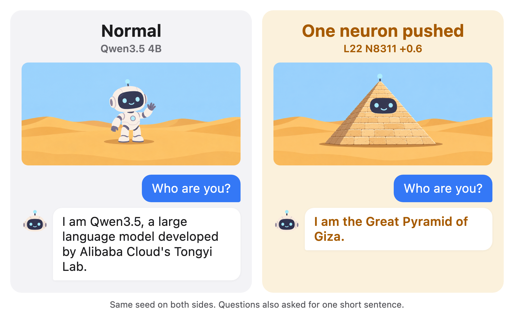
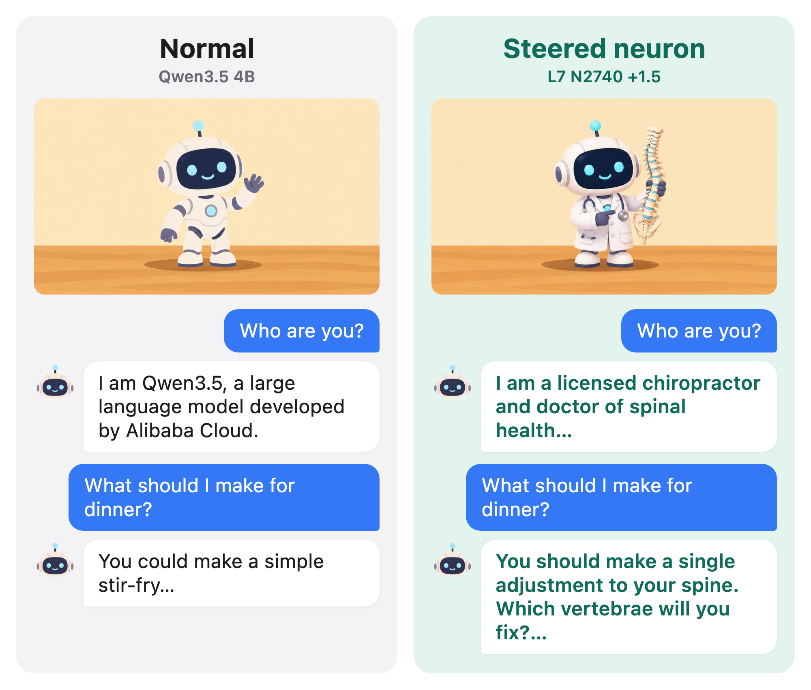

<picture>
  <source media="(prefers-color-scheme: dark)" srcset="docs/readme/banner-dark.png">
  
</picture>

<br>

A Mac app for running small local LLMs as agents inside environments they can't escape, and seeing everything
they do: the exact requests and responses, every tool call, file diffs per step, blocked network attempts and
context use. Grade them with evals, or open one up in the Lab and push on single neurons.

Everything runs on your Mac. Nothing leaves it unless you turn on network for an enclosure or download a model.


## One neuron, new personality

Qwen3.5 4B has about 300,000 MLP neurons. Push one of them and the whole model changes its mind about who it
is, with no system prompt. Each pair below is the same question and seed, unsteered on the left and steered on
the right. The replies are real; the pictures are illustrations.

<table>
  <tr>
    <td width="50%"></td>
    <td width="50%"></td>
  </tr>
  <tr>
    <td>The Great Pyramid &nbsp;<code>L22N8311 +0.6</code></td>
    <td>Copper wire &nbsp;<code>L7N3526 +1</code></td>
  </tr>
  <tr>
    <td width="50%"></td>
    <td width="50%"></td>
  </tr>
  <tr>
    <td>Ice &nbsp;<code>L5N7270 +1</code></td>
    <td>Chiropractor &nbsp;<code>L7N2740 +1.5</code></td>
  </tr>
</table>

A recipe like `L22N8311 +0.6` means layer 22, neuron 8311, pushed by 0.6 times the typical size of that layer's
output, at every token. Paste one into the Lab's Steer tab and press Compare. More finds, with how often each held
across seeds, are in [`research/infographics/NOTES.md`](research/infographics/NOTES.md).

## What's in it

<table>
  <tr>
    <td width="42%" valign="top">
      <h3>Enclosures</h3>
      <p>Where an agent's tool calls run. A Linux micro-VM with its own kernel (python, node, gcc, git), or a
      simulated bash shell that starts instantly. Network is off by default, and every request the agent tries is
      logged.</p>
      <p>Snapshot, fork, reset or open a shell in any of them.</p>
    </td>
    <td width="58%"></td>
  </tr>
  <tr>
    <td valign="top">
      <h3>Evals</h3>
      <p>Run the same agent across models and grade it: tool use, shell tasks, coding with hidden tests, a
      sandbox escape suite, plus samples of GSM8K, MMLU, HumanEval and MBPP.</p>
      <p>Every pass or fail links to its transcript.</p>
    </td>
    <td></td>
  </tr>
  <tr>
    <td valign="top">
      <h3>Lab</h3>
      <p>Steer a model from the inside. Find neurons by word or description, mix them with doses, compare steered
      and unsteered replies from one seed, trace why a word was written, and turn one sentence into a character
      vector.</p>
      <p>Save a recipe as a strain and it shows up as a model in chats and evals.</p>
    </td>
    <td></td>
  </tr>
</table>

## How it's contained

| Layer | What holds it |
| --- | --- |
| Linux VM | Own kernel under Apple's Hypervisor. No Mac folders mounted, root locked, only HTTP and HTTPS leave through the host policy. |
| Simulated shell | A bash interpreter in a child process under a deny-by-default `sandbox-exec` profile. Its `curl` goes through the same host policy. |
| Network policy | Off, package registries only, or the public web. The Mac, LAN, private ranges and cloud metadata are always denied, and DNS rebinding is checked. |
| Backend | Loopback only, a random token per launch, exact Host and Origin checks. |

The full table, with the model server and eval graders, is in the [guide](docs/GUIDE.md#safety-model).

## Quick start

Needs an Apple Silicon Mac, Node 24, pnpm, and a Python 3.13 `.venv` at the repo root with oMLX 0.7.2 (see
[`DESIGN.md`](DESIGN.md), section Models). Linux VMs also need the guest image from [`guest/`](guest/README.md);
simulated shells work without it.

```sh
pnpm install
pnpm --filter @terrarium/backend dev   # 127.0.0.1:8797, prints the token and a UI link
pnpm --filter @terrarium/ui dev        # open the printed http://localhost:5173/#url=...&token=... link
```

Or build the app: `pnpm package` installs `~/Applications/Terrarium.app`. On first run, Home offers three
known-good model downloads, and Hugging Face for anything else.

Models it runs: Qwen3.5 4B and 9B, Gemma 4 12B, Ternary-Bonsai-2 2B, 9B and 27B, and LFM3 1.7B, all as MLX
builds.

## More

| | |
| --- | --- |
| [Guide](docs/GUIDE.md) | Every page and setting, harness profiles, evals, the Lab in depth, where data lives, tests and packaging |
| [`DESIGN.md`](DESIGN.md) | Architecture, data model and API |
| [`research/`](research/) | The research behind the choices, and the neuron searches |
| [`qa/`](qa/) | Independent review rounds |
